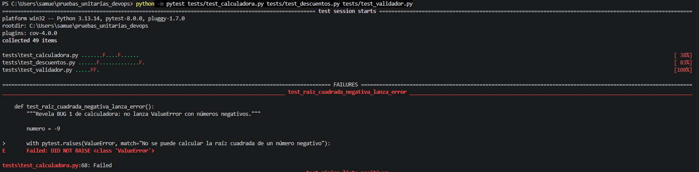
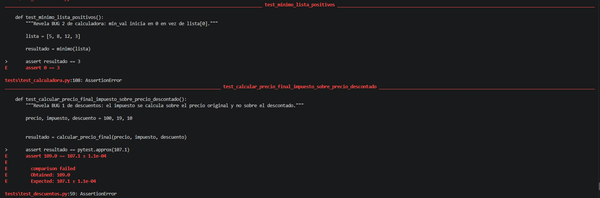
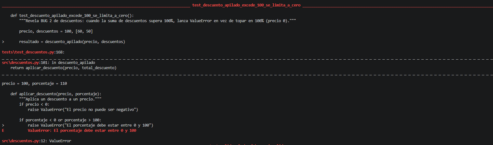
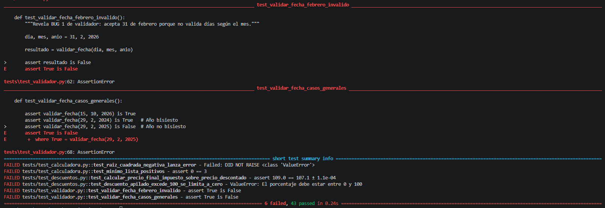

# Informe de Taller: Análisis y Mejora de Pruebas Unitarias

## 1. Datos
 SAMUEL GOMEZ GIRALDO
 CC1054859384
---

## 2. Análisis por Módulo

Para el desarrollo de este taller se trabajaron los dos módulos obligatorios (`calculadora.py` y `descuentos.py`) y un tercer módulo adicional (`validador.py`), estructurando todas las pruebas bajo el patrón **AAA (Arrange-Act-Assert)**.

### 2.1. Módulo `src/calculadora.py`
* **Qué hace:** Implementa operaciones aritméticas básicas (`sumar`, `restar`, `multiplicar`, `dividir`), potenciación, raíz cuadrada, funciones estadísticas sobre listas (`promedio`, `maximo`, `minimo`) y cálculo de área y perímetro de rectángulos.
* **Qué casos se decidieron probar y por qué:** Se probaron particiones de equivalencia con números positivos y negativos, priorizando los casos frontera donde suelen ocurrir fallos matemáticos: división entre cero (`b = 0`), raíz cuadrada de números negativos (`numero = -9`), listas vacías (`[]`) en funciones estadísticas, listas compuestas únicamente por números positivos mayores que cero (caso crítico que reveló que `minimo` inicializaba erróneamente su comparador en `0`), y dimensiones geométricas negativas.

### 2.2. Módulo `src/descuentos.py`
* **Qué hace:** Calcula descuentos porcentuales simples, montos de descuento, precios finales combinando descuentos e impuestos, descuentos escalonados por volumen de unidades, descuentos sucesivos (`descuento_cumulativo`) y descuentos sumados (`descuento_apilado`).
* **Qué casos se decidieron probar y por qué:** Se cubrieron todos los umbrales de volumen (`< 10`, `10`, `20`, `50` y `>= 100` unidades), listas de descuentos vacías y excepciones `ValueError` por precios, cantidades o impuestos negativos y porcentajes fuera del rango `[0, 100]`. Además, se diseñó una prueba financiera para verificar que el impuesto se calcule sobre el subtotal ya descontado y un caso límite donde la suma de descuentos apilados supera el `100%`.

### 2.3. Módulo `src/validador.py`
* **Qué hace:** Verifica la validez estructural de correos electrónicos, teléfonos, edades, contraseñas, URLs mediante expresiones regulares, fechas calendario y números de cédula.
* **Qué casos se decidieron probar y por qué:** Se evaluaron entradas vacías, tipos de datos inválidos, longitudes en los límites inferiores y superiores permitidos, ausencia de caracteres requeridos en contraseñas/emails y fechas límite de calendario (como el 31 de febrero o el 29 de febrero en años bisiestos vs. no bisiestos).

## 3. Tabla de Bugs Encontrados y Corregidos

Se encontraron, documentaron y corrigieron **5 bugs ocultos** (superando el mínimo de 3 requeridos e incluyendo un módulo adicional):

| # | Módulo | Función | Entrada que lo revela | Resultado erróneo | Resultado esperado | Corrección aplicada |
|---|---|---|---|---|---|---|
| 1 | `calculadora.py` | `raiz_cuadrada(numero)` | `numero = -9` | Retorna un número complejo `(1.8369e-16+3j)` sin lanzar excepción. | Lanzar `ValueError("No se puede calcular la raíz cuadrada de un número negativo")`. | Se añadió la validación `if numero < 0: raise ValueError(...)`. |
| 2 | `calculadora.py` | `minimo(lista)` | `lista = [5, 8, 12, 3]` | Retorna `0` porque inicializa `min_val = 0` en lugar de usar un elemento de la lista. | Retornar `3` (el valor mínimo real dentro de la lista). | Se cambió la inicialización a `min_val = lista[0]`. |
| 3 | `descuentos.py` | `calcular_precio_final(precio, impuesto, descuento)` | `precio=100, impuesto=19, descuento=10` | Retorna `109.0` (calcula el 19% de impuesto sobre el precio original de `100`). | Retornar `107.1` (calcular el 19% de impuesto sobre el precio ya descontado de `90`). | Se corrigió la fórmula a `impuesto_monto = precio_con_descuento * (impuesto / 100)`. |
| 4 | `descuentos.py` | `descuento_apilado(precio, descuentos)` | `precio=100, descuentos=[60, 50]` | Lanza `ValueError: El porcentaje debe estar entre 0 y 100` cuando la suma excede 100%. | Retornar `0.0` limitando el descuento acumulado máximo al `100%`. | Se acotó la suma con `total_descuento = min(sum(descuentos), 100)`. |
| 5 | `validador.py` | `validar_fecha(dia, mes, año)` | `dia=31, mes=2, año=2026` y `dia=29, mes=2, año=2025` | Retorna `True` para fechas inexistentes en el calendario (acepta hasta 31 días en cualquier mes). | Retornar `False` validando el número máximo de días según cada mes y si el año es bisiesto. | Se implementó una lista `dias_por_mes` ajustando febrero a 29 días únicamente en años bisiestos. |

### Evidencias de los Bugs Encontrados (Traceback en Rojo)

## 4. Cobertura y Ejecución en Verde

Salida obtenida al ejecutar `python -m pytest tests/test_calculadora.py tests/test_descuentos.py tests/test_validador.py --cov=src --cov-report=term-missing`:
'''
---------- coverage: platform win32, python 3.13.14-final-0 ----------
Name                       Stmts   Miss  Cover   Missing
--------------------------------------------------------
src\__init__.py                0      0   100%
src\autenticacion.py          42     42     0%   6-77
src\calculadora.py            44      0   100%
src\conversor.py              56     56     0%   6-94
src\csv_parser.py             76     76     0%   6-127
src\descuentos.py             58      0   100%
src\fibonacci.py              42     42     0%   6-73
src\manipulador_texto.py      93     93     0%   6-156
src\procesador_texto.py       49     49     0%   6-84
src\utils.py                  53     53     0%   6-92
src\validador.py              67      0   100%
--------------------------------------------------------
TOTAL                        580    411    29%
========================= 49 passed in 0.24s =========================
'''

## 5. Reflexion final
¿Qué NO mide la cobertura?

La cobertura básicamente te muestra qué líneas de código se alcanzaron a ejecutar cuando corriste las pruebas, pero no garantiza que esas líneas estén bien hechas o libres de fallos.Por ejemplo, la función de la raíz cuadrada podía ejecutarse completa y dar un 100% de cobertura, pero si a uno no se le ocurría probar qué pasaba con un número negativo, el error seguía ahí guardado aunque el reporte marcara que todo estaba cubierto.

¿Qué aprendí en este taller?

Aprendí que hacer buenas pruebas con la estructura AAA es ir más allá del caso feliz o mas ideal donde todo sale bien. Se trata de ponerse a pensar en los casos raros, en los límites y en las cosas que uno cree que nunca van a pasar, porque ahí es donde casi siempre se esconden los problemas.También me quedó muy clara la ventaja de ser ordenado en GitHub: separar los commits de las pruebas de los commits donde arreglas los fallos (fixes) hace que el trabajo sea mucho más fácil de entender, revisar y mantener al día.